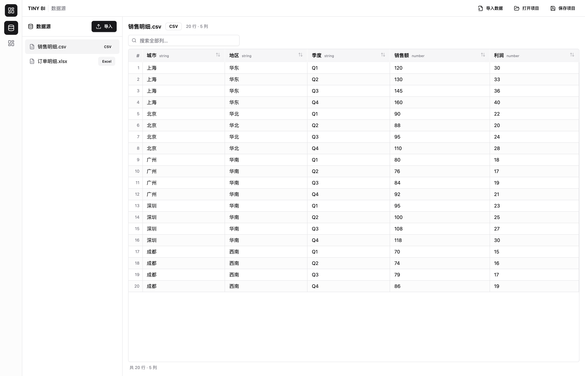
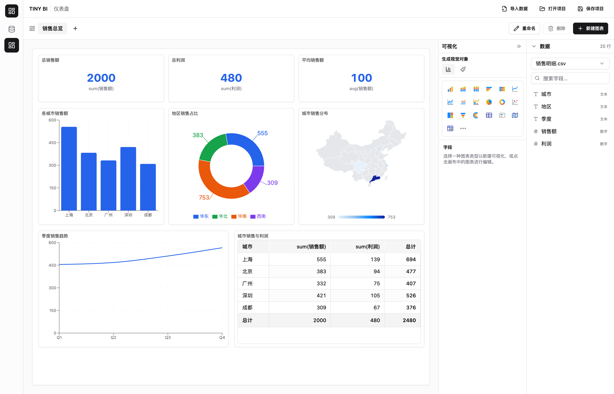

# TinyBI

> 一款面向 macOS 的轻量级桌面 BI 工具 —— 导入本地数据，拖拽字段，分钟级做出交互式仪表盘。

TinyBI 使用 **Tauri 2 + Vite + React + TypeScript** 构建，界面与交互对齐 Power BI 的使用习惯：左侧导航、数据源预览、报告页画布、可拖拽的字段/可视化面板。所有 CSV / Excel 数据均在 WebView 内本地解析，无需上传，无需后端服务。



## 功能特性

### 数据导入与预览
- **CSV / Excel 导入**：支持 `.csv`（papaparse）与 `.xlsx` / `.xls`（SheetJS），文件由 Tauri 读取二进制，WebView 内解析。
- **数据源管理**：左侧列表统一管理多个数据集，标注来源类型（CSV / Excel / SQL）与行列规模，支持删除。
- **数据预览表格**：完整的表头类型标注、行号、滚动与搜索，导入即可核对数据。

### 仪表盘与可视化
- **19 种视觉对象**：簇状柱形图、堆积柱形图、100% 堆积柱形图、条形图、堆积条形图、折线图、面积图、堆积面积图、折线与柱形图（组合图）、饼图、环形图、散点图、树状图、漏斗图、径向条形图、表格、数值卡（KPI）、填充地图、数据透视表。
- **拖拽式画布**：视觉对象在报告页上以绝对像素定位，可自由拖动、缩放、删除，容量与 Power BI 报表页一致。
- **字段/可视化面板**：右侧并排「可视化」与「数据」两栏，选择图表类型、把字段拖入维度/度量/图例等槽位即可实时出图。
- **聚合与自动标题**：支持求和 / 计数 / 平均 / 最小 / 最大等聚合，未自定义标题时按「求和(销售额) 按 城市」风格自动生成。
- **填充地图**：内置中国 / 世界地理边界，按地区自动着色。
- **数据透视表**：支持多度量交叉、行列总计。

### 交互与协作
- **交叉高亮**：点击某个图元即可高亮其他视觉对象中对应的数据，`Esc` 或点击空白清除。
- **多仪表盘管理**：顶部页签切换、新建、重命名、删除仪表盘，每个仪表盘独立维护自己的视觉对象。



### 项目持久化
- **`.biproj` 项目文件**：一键保存 / 打开，完整保留数据源、仪表盘布局与连接配置。
- **版本迁移**：项目文件带版本号，旧版本布局会自动迁移到当前像素坐标系。
- **密码安全**：连接密码默认不写入项目文件，仅在显式勾选「包含连接密码」时才落盘。

## 技术栈

| 层 | 技术 |
| --- | --- |
| 桌面壳 | Tauri 2（macOS `.app`，WKWebView） |
| 前端 | Vite 6 · React 18 · TypeScript 5 |
| UI | shadcn/ui · Radix UI · Tailwind CSS |
| 图表 | Recharts · 自研填充地图 / 数据透视表 |
| 状态 | Zustand · TanStack Query |
| 数据解析 | papaparse（CSV）· SheetJS/xlsx（Excel） |
| 远程数据 | Rust `tiberius` + `tokio`（SQL Server，经 IPC 调用） |

## 架构设计

```
┌──────────────────────────── Tauri 应用 ────────────────────────────┐
│                                                                    │
│  React 前端 (WebView)              Rust 后端 (IPC)                 │
│  ├─ 数据源视图 / 仪表盘视图         ├─ read_file_bytes / write_text │
│  ├─ Zustand 状态仓库               ├─ test_sqlserver_connection    │
│  ├─ 本地解析 CSV / Excel           ├─ execute_sql_query            │
│  └─ 图表渲染 / 拖拽画布            └─ tiberius → 远程 SQL Server   │
│                                                                    │
└────────────────────────────────────────────────────────────────────┘
```

核心约束（见 [CLAUDE.md](CLAUDE.md)）：
- 不使用 Python / FastAPI / sidecar，不内置本地数据库（如 DuckDB）。
- 不做 LLM / NL2SQL 相关能力。
- CSV / Excel 在 WebView 内解析；SQL Server 连接逻辑全部位于 Rust，前端仅通过 IPC 调用。
- 不引入 Next.js / Nuxt / Electron。

## 目录结构

```
src/
├─ App.tsx                 # 应用外壳：侧边导航 + 顶栏 + 视图切换
├─ components/             # 通用组件与 shadcn/ui 基础组件
│  └─ DataTable.tsx        # 数据预览表格
├─ features/
│  ├─ datasource/          # 数据源视图
│  ├─ dashboard/           # 仪表盘视图、报告画布、图表渲染、字段/可视化面板
│  └─ sql/                 # SQL Server 连接与查询界面
├─ lib/                    # csv / xlsx 解析、聚合、透视、地理、画布、项目文件等纯函数
├─ services/               # Tauri IPC 封装
├─ stores/                 # Zustand 状态仓库
└─ types.ts                # 全局数据模型

src-tauri/                 # Rust 侧：IPC 命令、文件读写、SQL Server 连接
docs/images/               # README 界面截图
```

## 开发与构建

环境要求：Node.js ≥ 22、pnpm、Rust 工具链（构建桌面端时）。

```bash
# 安装依赖
pnpm install

# 仅启动前端（浏览器中调试 UI）
pnpm dev

# 启动桌面应用（Tauri）
pnpm tauri dev

# 类型检查 + 构建前端产物
pnpm build

# 打包 macOS .app
pnpm tauri build

# 运行单元测试
pnpm test
```

## 项目文件格式（.biproj）

`.biproj` 为 JSON 文本，包含三部分内容与一个版本号：

```jsonc
{
  "version": 2,
  "connections": [ /* SQL Server 连接配置（默认不含密码） */ ],
  "datasets":    [ /* 数据集：列定义 + 行数据 */ ],
  "dashboards":  [ /* 仪表盘：名称 + 视觉对象列表 */ ]
}
```

> 说明：`version` 用于布局迁移。v2 起视觉对象使用绝对像素坐标（`x / y / w / h`），旧的网格布局会在打开时自动换算。
